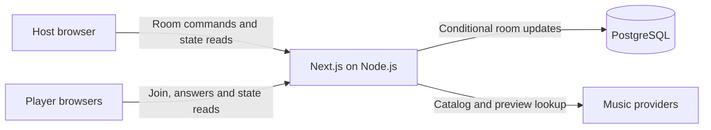

# «На слух» · Multiplayer music quiz

«На слух» is a browser music quiz for groups. The host creates a room and shares a join code or QR link. Players hear a short music preview, give answers, and follow a shared scoreboard.

[Open the game](https://на-слух.рф/) · [LatWorks portfolio](https://latworks.ru/)

## Architecture

React and TypeScript render separate views for the host and players. Next.js route handlers validate room commands and produce role-specific responses. The deployed VPS setup uses Nginx for HTTPS and systemd to run the Node.js application.

## Synchronizing a room

The server stores the room as serialized state with a numeric version and expiration time. A mutation reads the state, applies the game rules, and writes only when the stored version still matches the version it read. If another request wins, the handler reloads and retries a bounded number of times. This protects the room from lost updates when a host and multiple players act together.

Clients poll for a view of the current room. The server advances timed phases using its own clock and returns timing information for display. Clients can refresh after reconnecting and recover the current server state.

## Engineering decisions

- **Scoring.** Server-side rules handle full and partial credit and cancel a scored response when the host reverses it.
- **Room creation.** An idempotency key lets a retry recover the result of a successful room purchase if the browser missed the response. The account balance and room purchase are handled together.
- **Music previews.** Provider integration is separate from room rules. The quiz works with short preview fragments and keeps audio-provider lookup outside scoring.
- **Role boundaries.** A room code locates a room, while separate credentials identify the host and each participant. State views are filtered by role. Account moderation and session revocation are enforced on the server.

## Verification

The private codebase includes unit tests for game rules and integration scenarios covering concurrent updates, room-creation retries, and account balance changes.
